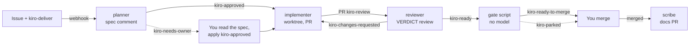

# Kiro Crew Software Factory: from GitHub issue to reviewed pull request

> **Proof of concept.** This is a POC. It still needs to be tested and validated before you rely on it, and it should not be used on anything you cannot afford to review carefully.

**Write an issue. Add a label. Get a specified, implemented, independently reviewed, gate-checked pull request.** Five small Kiro Crew agents on a machine you control each do one job and hand off through GitHub labels. You decide what ships.

## What is Kiro Crew

[Kiro](https://kiro.dev) is a software engineering agent available as an IDE, a CLI, a web app, a mobile app and **[Kiro Crew](https://kiro.dev/crew/)**. Kiro Crew is an open source development workspace that runs locally or remotely on your own hardware and keeps its context across sessions. See the [Kiro docs](https://kiro.dev/docs/crew/) and the [GitHub repo](https://github.com/kirodotdev/KiroCrew) (Apache-2.0).

This project uses three of its features:

- **Webhooks:** an authenticated endpoint that starts an agent when an outside event arrives. Here every event is a GitHub label.
- **Agent templates:** named agents with their own instructions and tools. Here, five roles: planner, implementer, reviewer, scribe and auditor, each a template file under `~/.kiro/agents/`.
- **Host guardrails:** tool approval, denied commands, sandboxing and an audit log apply to what each agent does.

## Why a "software factory"

The Kiro team describes building Kiro Crew with a [software factory](https://kiro.dev/blog/software-factory-1000-prs/): an assembly line of agent stages (triage, implement, review, merge) with a queue between them. Their advice for starting is to build a pipeline before an orchestrator, and that "labels on a GitHub issue are a perfectly good queue to start with".

This project takes that literally. GitHub labels are the queue, the state machine and the audit trail. There is no orchestrator: each stage is an agent that reads one label and writes the next, and a deterministic script decides "ready to merge". A human merges.

| Factory stage | Here | Label in | Label out |
|---|---|---|---|
| Specify | `delivery-planner` writes an AIDLC spec as an issue comment | `kiro-deliver` | `kiro-approved` (or `kiro-needs-owner`) |
| Implement | `delivery-implementer` builds in a fresh worktree, opens the PR | `kiro-approved` | `kiro-review` |
| Review | `delivery-reviewer` reviews against the spec, posts a `VERDICT:` | `kiro-review` | `kiro-ready` or `kiro-changes-requested` |
| Fix | `delivery-implementer` again, at most 3 rounds | `kiro-changes-requested` | `kiro-review` |
| Gate | `kiro_gate.py`, no model: head SHA reviewed, CI green, files in scope, spec hash | `kiro-ready` | `kiro-ready-to-merge` or `kiro-parked` |
| Ship | You merge | | |
| Document | `delivery-scribe` opens a docs-only PR | merged `kiro/issue-N` | |
| Watch | `delivery-auditor` reports stalls (the only thing that polls) | timer | |

A fast lane still exists: label an issue `kiro-task` and `github-worker` implements the issue text directly with no spec, review or gate.

In testing, a labelled issue became a `kiro-ready-to-merge` pull request in 4 to 8 minutes with no human in the loop, on a Mac laptop and on an EC2 instance. Each handoff fired within 3 to 10 seconds of the previous label.

## How it works



Everything runs on your machine. A self-hosted Actions runner turns each label event into a signed webhook to the local Kiro Crew gateway; the gateway runs the agent for that label; its shell, git and tests execute on your disk. GitHub only stores issues, labels, branches and PRs and fires the events. Only the repository owner's labels start work, and nothing merges on its own. [Doc 03](docs/03-delivery-lifecycle.md) is the full picture; [Doc 02](docs/02-how-it-works.md) walks the fast lane step by step.

## Quick start

New here? Follow **[docs/01, the zero-to-first-PR checklist](docs/01-quickstart-checklist.md)**: one ordered list with a checkbox per step. The summary below is for people who have done it before.

You need:

- a **private** GitHub repository you own personally (not an org), with a CI workflow that runs on pull requests;
- **Kiro Crew 0.11 or newer**, running and signed in to a model, on the machine that will do the work: your laptop, an EC2 instance, or a container ([docs/07](docs/07-run-on-a-remote-machine.md) has the per-host differences; laptop and EC2 are tested);
- `gh` logged in as the owner, plus `git`, `python3`, `curl`, `shasum`, and the runtime your CI uses (for Node projects, the same Node major). On Linux these must end up in `/usr/bin`; `scripts/setup-gateway.sh` tells you how.

**1. Kiro Crew side** (see [docs/03](docs/03-delivery-lifecycle.md) and [docs/05](docs/05-kiro-crew-setup.md)):

```bash
git clone https://github.com/aidin-repo/kiro-crew-software-factory
cd kiro-crew-software-factory
scripts/install-agent.sh
scripts/setup-gateway.sh    # auto-approve rules + trusted program paths; run its "->" lines, re-run
```

Webhook runs are unattended, so `setup-gateway.sh` is what lets the agents run `gh`, `git`, `npm` and the file tools at all. Then under **Settings → Webhooks** create one signed source per template with **New** (planner, implementer, reviewer, scribe, worker), picking the template as the Agent. Copy every token and signing secret when shown; they appear once. Sources belong to this gateway: a new machine needs new sources.

**2. GitHub side.** Replace `OWNER/REPO` and `~/code/REPO`:

```bash
gh auth setup-git
scripts/setup-github.sh OWNER/REPO       # labels + one secret pair per template (prompts for each)
scripts/install-into-repo.sh ~/code/REPO # workflow, dispatcher, gate, tests, agent templates
scripts/install-runner.sh OWNER/REPO
```

`install-into-repo.sh` only copies files and prints the commit commands. Merge that change to the default branch before testing, because the workflow only fires from there.

**3. Start the runner.** In a terminal you keep open, or as a service so it survives logout (`SERVICE=1 scripts/install-runner.sh OWNER/REPO`), or with `nohup` in a container:

```bash
cd ~/actions-runner-kirocrew && ./run.sh
```

**4. Verify.** Wait for "Listening for Jobs", then:

```bash
scripts/preflight.sh OWNER/REPO
CLEANUP=1 scripts/smoke-test.sh OWNER/REPO
```

Then write a real issue and add `kiro-deliver`. Watch the labels move on the issue, then on the PR. When the PR reads `kiro-ready-to-merge`, read the reviewer's `VERDICT:` and the gate comment, and merge.

## Security model

An issue's text can influence a program that has shell access to your machine, so the guardrails matter.

- **Private repositories only.** The setup scripts refuse any repository that is not private.
- **Owner-gated at every hop.** The dispatcher re-checks each event: the owner wrote the issue, the owner applied the label, the PR is on `kiro/issue-N` in this repository and still open. A collaborator's label starts nothing.
- **Issue text is data.** It is base64-encoded into a marked untrusted block, after hidden HTML comments and invisible characters are removed, so the agent reads what you read. Agents never run commands copied from it and refuse to widen scope or touch workflows, credentials, deployment or infrastructure.
- **The spec is the contract.** The implementer builds only the files the owner-approved spec lists; the PR body carries the spec's URL and SHA-256; the reviewer and the gate both verify it.
- **One agent, one job, one token.** Each stage runs as its own template with its own webhook source in its own ephemeral session, so a stage cannot borrow another's permissions and the reviewer never reads the implementer's session.
- **Trusted code only.** Jobs check out the default branch. The gate never checks out PR code; it reads the GitHub API.
- **Signed and loopback.** The dispatcher sends a bearer token plus an HMAC signature, refuses any non-loopback webhook URL, ignores proxy settings and never follows a redirect.
- **No merge, no deploy.** `kiro-ready-to-merge` is the pipeline's last word. Protect the default branch with a ruleset that requires a pull request and does not let admins bypass it (docs/04, section 4.5).
- **Rounds are capped.** Three review rounds, then the gate parks the PR for you.
- **It runs shell commands as you.** Commits, reviews and PRs appear under your GitHub account, so treat the label like typing the command yourself.

The owner checks, loopback rule, signature, scope check and round cap are enforced in code. Rules such as "do not touch workflows" live in the agents' prompts, which is a weaker layer.

## Limitations

- **The machine must be on** and the runner running, or labelled issues queue in GitHub Actions. The optional auditor mate exists to tell you when something has stalled.
- **One branch per issue.** `kiro/issue-N` is fixed, so a second implementation of the same issue stops. Use a new issue or delete the branch.
- **No live steering.** Each webhook run is unattended and ephemeral. You see its report as a dashboard notification when it finishes, and PR comments do not reach an agent; labels do.
- **Comment reviews, not approvals.** The reviewer posts a `--comment` review because GitHub refuses approve/request-changes on your own PR. The gate reads the `VERDICT:` line instead of review state.
- **Unattended host policy.** A webhook turn runs only the tool calls that match an auto-approve rule in the gateway's config, and only for programs in a trusted system directory (`/usr/bin`), given as one plain shell line. `scripts/setup-gateway.sh` sets this up; docs/05, section 5.5 explains it. Switching Node versions with nvm stays refused, so `/usr/bin/node` must be the major your CI uses. On macOS, programs outside `/usr/bin` need a one-time approval per gateway start.
- **Needs CI.** The gate requires at least one CI check on the PR head. A repository with no CI workflow parks every PR until you set `KIRO_GATE_REQUIRE_CI: "false"` on the `pr-gate` job.
- **Gateway port.** The dispatcher assumes `127.0.0.1:5476`. Set `KIROCREW_WEBHOOK_URL` in the workflow if yours differs; non-loopback addresses are refused.

## Documentation

The numbers are the reading order: 01, then 02, then whatever you need. Opening this repository in a coding agent (Kiro, Claude Code, Codex, Cursor)? It reads [`AGENTS.md`](AGENTS.md) and can walk you through the install, handing you the steps only a human can do.

| Doc | What it covers |
|---|---|
| [01 Quick start checklist](docs/01-quickstart-checklist.md) | **Start here.** Zero to first PR, one ordered list |
| [02 How it works](docs/02-how-it-works.md) | Using it day to day: write the issue, add the label, read the PR; what happens behind the scenes; the labels |
| [03 Delivery lifecycle reference](docs/03-delivery-lifecycle.md) | The roles, where to watch a run, trust boundaries, where it runs |
| [04 GitHub activation](docs/04-github-activation.md) | Labels, secrets, workflow, runner, branch protection, in detail |
| [05 Kiro Crew setup](docs/05-kiro-crew-setup.md) | Templates, webhook sources, the unattended approval policy, the optional auditor mate |
| [06 Testing](docs/06-testing.md) | Unit tests, preflight, smoke test, sample issues, negative tests, re-running a hop |
| [07 Run it anywhere](docs/07-run-on-a-remote-machine.md) | Laptop, EC2 or a container: what differs per host, the tested EC2 steps, a container recipe |
| [08 Customizing the agents](docs/08-customizing-the-agents.md) | Your own prompts, other languages and tools, new roles, and the contracts you must keep |
| [09 Lessons and troubleshooting](docs/09-lessons-and-troubleshooting.md) | Symptom table, what went wrong while building this, how to read the evidence |

The folders are `templates/` (workflow, dispatcher, gate, tests, agent prompts) and `scripts/`:

| Script | Does |
|---|---|
| `install-agent.sh` | Copies the six templates into `~/.kiro/agents/`; files in `templates/agent.local/` override them; `--keep` protects in-place edits |
| `setup-gateway.sh` | Writes the unattended auto-approve rules, checks program paths and the credential helper, prints the fixes |
| `setup-github.sh OWNER/REPO` | Creates the labels, stores the ten webhook secrets |
| `install-into-repo.sh PATH` | Copies the workflow, dispatcher, gate and tests into your clone |
| `install-runner.sh OWNER/REPO` | Downloads, verifies and registers the runner; `SERVICE=1` also installs it as a service |
| `preflight.sh OWNER/REPO` | Read-only check of everything above |
| `smoke-test.sh OWNER/REPO` | Runs one real issue through the whole lifecycle |
