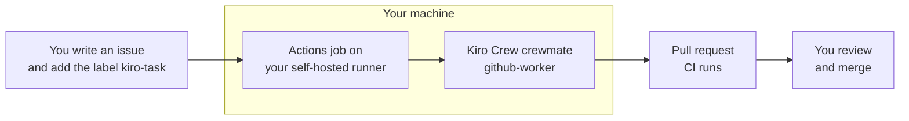

# Kiro Crew Software Factory: from GitHub issue to pull request

> **Proof of concept.** This is a POC. It still needs to be tested and validated before you rely on it, and it should not be used on anything you cannot afford to review carefully.

**Write an issue. Add a label. Get a pull request.** A Kiro Crew crewmate on a machine you control writes the change, runs the tests and opens the PR. You decide what ships.

## What is Kiro Crew

[Kiro](https://kiro.dev) is a software engineering agent available as an IDE, a CLI, a web app, a mobile app and **[Kiro Crew](https://kiro.dev/crew/)**. Kiro Crew is an open source development workspace that runs locally or remotely on your own hardware and keeps its context across sessions. See the [Kiro docs](https://kiro.dev/docs/crew/) and the [GitHub repo](https://github.com/kirodotdev/KiroCrew) (Apache-2.0).

This project uses three of its features:

- **Webhooks:** an authenticated endpoint that starts an agent when an outside event arrives. Here the event is a GitHub label.
- **Crewmates:** named agents with their own instructions and tools. Here, `github-worker` does the coding.
- **Host guardrails:** tool approval, denied commands, sandboxing and an audit log apply to what the agent does.

## Why a "software factory"

The Kiro team describes building Kiro Crew with a [software factory](https://kiro.dev/blog/software-factory-1000-prs/): an assembly line of agent stages (triage, implement, review, merge) with a queue between them. Their advice for starting is to build a pipeline before an orchestrator, and that "labels on a GitHub issue are a perfectly good queue to start with".

This project is that idea at the smallest useful size: one stage, one worker, and a human at the end of the line.

| Factory | Here |
|---|---|
| Queue | A GitHub issue with the `kiro-task` label |
| Assembly line | The Actions job on your runner and the dispatcher script |
| Worker (the "implement" stage) | The `github-worker` crewmate |
| Product | A branch and a pull request |
| Quality control (the "review" stage) | CI, your review, and an optional Kiro Crew review (docs/01, section 1.6) |
| Shipping (the "merge" stage) | You merge, by design |

It covers the implement stage only. Triage, merge and a coordinating agent are not part of it, and it is a starting point for a factory, not the 1,000-PRs-a-week version. In our tests, four issues each became a pull request in about one to two and a half minutes.

## How it works



Only the repository owner's label starts work. The crewmate never merges or deploys. You do. [Doc 00](docs/00-how-it-works.md) shows what runs where, step by step.

## Quick start

You need a **private** GitHub repository you own, the `gh` CLI logged in as the owner, Python 3, and Kiro Crew running on the machine that will do the work. That machine can be your laptop or a remote Kiro Crew machine such as a dev box or an EC2 instance, which stays on when your laptop does not ([docs/05](docs/05-run-on-a-remote-machine.md), not yet tested).

**1. Kiro Crew side** (in the dashboard, see [docs/02](docs/02-kiro-crew-setup.md)):

- Create the `github-worker` crewmate with the prompt in `templates/agent/github-worker.json`.
- Create a signed webhook source routed to `github-worker`. Copy the token and signing secret now, because they are shown once.
- Quit and reopen Kiro Crew, then check that the `KIRO_AGENT` column for `github-worker` says `github-worker`:

```bash
kirocrew agent list
```

**2. GitHub side.** Replace `OWNER/REPO` and `~/code/REPO` with your own values:

```bash
cd kiro-crew-issue-to-pr
export KIROCREW_WEBHOOK_TOKEN='paste-the-token-here'
export KIROCREW_WEBHOOK_SIGNING_SECRET='paste-the-signing-secret-here'
scripts/setup-github.sh OWNER/REPO
scripts/install-into-repo.sh ~/code/REPO
scripts/install-runner.sh OWNER/REPO
```

`install-into-repo.sh` only copies files and prints the commit commands. Merge that change to the default branch before testing, because the workflow only fires from there.

**3. Start the runner** in its own terminal and leave it open:

```bash
cd ~/actions-runner-kirocrew
```

```bash
./run.sh
```

**4. Verify.** Wait for "Listening for Jobs" first:

```bash
scripts/preflight.sh OWNER/REPO
```

```bash
CLEANUP=1 scripts/smoke-test.sh OWNER/REPO
```

Then write a real issue and add the `kiro-task` label. Docs 00 and 03 have sample issues.

## Security model

An issue's text can influence a program that has shell access to your machine, so the guardrails matter.

- **Private repositories only.** The setup scripts refuse public repos.
- **Owner-gated.** Work starts only if the repository owner applied `kiro-task`. That verified approval is why the crewmate treats the issue as the specification.
- **Issue text is data.** It is base64-encoded into a marked untrusted block. The crewmate never runs commands copied from it and refuses to widen scope or touch workflows, credentials, deployment or infrastructure.
- **Trusted code only.** The job checks out the default branch, never PR code.
- **Signed and loopback.** The dispatcher sends a bearer token plus an HMAC signature, and refuses any non-loopback webhook URL.
- **No merge, no deploy.** The crewmate pushes only `kiro/issue-N` and opens a PR. Add branch protection so a review is required.
- **It runs shell commands as you.** Commits and PRs appear under your GitHub account, so treat the label like typing the command yourself.

The owner check, loopback rule and signature are enforced in code. Rules such as "do not touch workflows" live in the crewmate's prompt, which is a weaker layer.

## Limitations

- **The machine must be on** and the runner running, or labelled issues queue in GitHub Actions.
- **One run per issue.** The branch `kiro/issue-N` is fixed, so a second run on the same issue stops. Use a new issue or delete the branch.
- **No live steering.** Each webhook run is unattended and ephemeral. You see its report as a dashboard notification when it finishes, and PR comments do not reach the crewmate.
- **No automatic PR review** by default. It can be turned on (docs/01, section 1.6).

## Documentation

| Doc | What it covers |
|---|---|
| [00 How it works](docs/00-how-it-works.md) | Start here: the four steps to use it and what happens behind the scenes |
| [01 GitHub activation](docs/01-github-activation.md) | Label, secrets, workflow, runner, optional PR review |
| [02 Kiro Crew setup](docs/02-kiro-crew-setup.md) | Webhook source, the `github-worker` crewmate, routing, approvals |
| [03 Testing](docs/03-testing.md) | Unit tests, preflight, smoke test, sample issues, negative tests |
| [04 Lessons and troubleshooting](docs/04-lessons-and-troubleshooting.md) | What went wrong while building this, and the fixes |
| [05 Run on a remote machine](docs/05-run-on-a-remote-machine.md) | Use a dev box or EC2 instance instead of your laptop (not yet tested) |

The folders are `templates/` (workflow, dispatcher, crewmate prompt) and `scripts/` (setup, install, preflight, smoke test).
