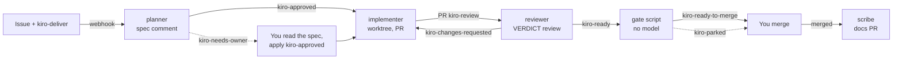

# Kiro Crew Software Factory: from GitHub issue to reviewed pull request

> **Proof of concept.** This is a POC. It still needs to be tested and validated before you rely on it, and it should not be used on anything you cannot afford to review carefully.

**Write an issue. Add a label. Get a specified, implemented, independently reviewed, gate-checked pull request.** Five small Kiro Crew mates on a machine you control each do one job and hand off through GitHub labels. You decide what ships.

## What is Kiro Crew

[Kiro](https://kiro.dev) is a software engineering agent available as an IDE, a CLI, a web app, a mobile app and **[Kiro Crew](https://kiro.dev/crew/)**. Kiro Crew is an open source development workspace that runs locally or remotely on your own hardware and keeps its context across sessions. See the [Kiro docs](https://kiro.dev/docs/crew/) and the [GitHub repo](https://github.com/kirodotdev/KiroCrew) (Apache-2.0).

This project uses three of its features:

- **Webhooks:** an authenticated endpoint that starts an agent when an outside event arrives. Here every event is a GitHub label.
- **Mates (crewmates):** named agents with their own instructions, tools and memory. Here, five of them: planner, implementer, reviewer, scribe and auditor.
- **Host guardrails:** tool approval, denied commands, sandboxing and an audit log apply to what each mate does.

## Why a "software factory"

The Kiro team describes building Kiro Crew with a [software factory](https://kiro.dev/blog/software-factory-1000-prs/): an assembly line of agent stages (triage, implement, review, merge) with a queue between them. Their advice for starting is to build a pipeline before an orchestrator, and that "labels on a GitHub issue are a perfectly good queue to start with".

This project takes that literally. GitHub labels are the queue, the state machine and the audit trail. There is no orchestrator: each stage is a mate that reads one label and writes the next, and a deterministic script decides "ready to merge". A human merges.

| Factory stage | Here | Label in | Label out |
|---|---|---|---|
| Specify | `delivery-planner` writes an AIDLC spec as an issue comment | `kiro-deliver` | `kiro-approved` (or `kiro-needs-owner`) |
| Implement | `delivery-implementer` builds in a fresh worktree, opens the PR | `kiro-approved` | `kiro-review` |
| Review | `delivery-reviewer` reviews against the spec, posts a `VERDICT:` | `kiro-review` | `kiro-ready` or `kiro-changes-requested` |
| Fix | `delivery-implementer` again, at most 3 rounds | `kiro-changes-requested` | `kiro-review` |
| Gate | `kiro_gate.py`, no model: head SHA reviewed, CI green, files in scope, spec hash | `kiro-ready` | `kiro-ready-to-merge` or `kiro-parked` |
| Ship | You merge | | |
| Document | `delivery-scribe` opens a docs-only PR | merged `kiro/issue-N` | |
| Watch | `delivery-auditor` reports stalls (the only thing that polls) | timer | |

A fast lane still exists: label an issue `kiro-task` and `github-worker` implements the issue text directly with no spec, review or gate.

In our tests a labelled issue became a `kiro-ready-to-merge` pull request in 6 to 8 minutes with no human in the loop. Each handoff fired within 3 to 10 seconds of the previous label.

## How it works



Everything runs on your machine. A self-hosted Actions runner turns each label event into a signed webhook to the local Kiro Crew gateway; the gateway runs the mate; the mate's shell, git and tests execute on your disk. GitHub only stores issues, labels, branches and PRs and fires the events. Only the repository owner's labels start work, and nothing merges on its own. [Doc 06](docs/06-delivery-lifecycle.md) is the full picture; [Doc 00](docs/00-how-it-works.md) walks the fast lane step by step.

## Quick start

You need a **private** GitHub repository you own, the `gh` CLI logged in as the owner, Python 3, and Kiro Crew running on the machine that will do the work. That machine can be your laptop or a remote Kiro Crew machine such as a dev box or an EC2 instance ([docs/05](docs/05-run-on-a-remote-machine.md), not yet tested).

**1. Kiro Crew side** (see [docs/06](docs/06-delivery-lifecycle.md) and [docs/02](docs/02-kiro-crew-setup.md)):

```bash
git clone https://github.com/aidin-repo/kiro-crew-software-factory
cd kiro-crew-software-factory
scripts/install-agent.sh
```

Then create the mates it prints (one per template; names must differ from the template names), and on the dashboard **Webhooks** page create one signed source per mate, each routed to its mate. Copy every token and signing secret when shown; they appear once.

**2. GitHub side.** Replace `OWNER/REPO` and `~/code/REPO`:

```bash
gh auth setup-git
scripts/setup-github.sh OWNER/REPO       # labels + one secret pair per mate (prompts for each)
scripts/install-into-repo.sh ~/code/REPO # workflow, dispatcher, gate, tests, mate templates
scripts/install-runner.sh OWNER/REPO
```

`install-into-repo.sh` only copies files and prints the commit commands. Merge that change to the default branch before testing, because the workflow only fires from there.

**3. Start the runner** in its own terminal and leave it open:

```bash
cd ~/actions-runner-kirocrew && ./run.sh
```

**4. Verify.** Wait for "Listening for Jobs", then:

```bash
scripts/preflight.sh OWNER/REPO
CLEANUP=1 scripts/smoke-test.sh OWNER/REPO
```

Then write a real issue and add `kiro-deliver`. Watch the labels move on the issue, then on the PR. When the PR reads `kiro-ready-to-merge`, read the reviewer's `VERDICT:` and the gate comment, and merge.

## Security model

An issue's text can influence a program that has shell access to your machine, so the guardrails matter.

- **Private repositories only.** The setup scripts refuse any repository that is not private.
- **Owner-gated at every hop.** The dispatcher re-checks each event: the owner wrote the issue, the owner applied the label, the PR is on `kiro/issue-N` in this repository and still open. A collaborator's label starts nothing.
- **Issue text is data.** It is base64-encoded into a marked untrusted block, after hidden HTML comments and invisible characters are removed, so the agent reads what you read. Mates never run commands copied from it and refuse to widen scope or touch workflows, credentials, deployment or infrastructure.
- **The spec is the contract.** The implementer builds only the files the owner-approved spec lists; the PR body carries the spec's URL and SHA-256; the reviewer and the gate both verify it.
- **One mate, one job, one token.** Each stage runs as its own mate on its own memory with its own webhook source, so the reviewer never shares state with the implementer and a stage cannot borrow another's permissions.
- **Trusted code only.** Jobs check out the default branch. The gate never checks out PR code; it reads the GitHub API.
- **Signed and loopback.** The dispatcher sends a bearer token plus an HMAC signature, refuses any non-loopback webhook URL, ignores proxy settings and never follows a redirect.
- **No merge, no deploy.** `kiro-ready-to-merge` is the pipeline's last word. Protect the default branch with a ruleset that requires a pull request and does not let admins bypass it (docs/01, section 1.5).
- **Rounds are capped.** Three review rounds, then the gate parks the PR for you.
- **It runs shell commands as you.** Commits, reviews and PRs appear under your GitHub account, so treat the label like typing the command yourself.

The owner checks, loopback rule, signature, scope check and round cap are enforced in code. Rules such as "do not touch workflows" live in the mates' prompts, which is a weaker layer.

## Limitations

- **The machine must be on** and the runner running, or labelled issues queue in GitHub Actions. The auditor mate exists to tell you when something has stalled.
- **One branch per issue.** `kiro/issue-N` is fixed, so a second implementation of the same issue stops. Use a new issue or delete the branch.
- **No live steering.** Each webhook run is unattended and ephemeral. You see its report as a dashboard notification when it finishes, and PR comments do not reach a mate; labels do.
- **Comment reviews, not approvals.** The reviewer posts a `--comment` review because GitHub refuses approve/request-changes on your own PR. The gate reads the `VERDICT:` line instead of review state.
- **Unattended host policy.** Some commands (switching Node versions with nvm, running npm lifecycle scripts) are refused in unattended turns. The mates fall back to CI's results and say so in the review.

## Documentation

| Doc | What it covers |
|---|---|
| [06 Delivery lifecycle](docs/06-delivery-lifecycle.md) | Start here: the five mates, the labels, setup, trust boundaries |
| [00 How it works](docs/00-how-it-works.md) | The fast lane (`kiro-task`) step by step, and what runs where |
| [01 GitHub activation](docs/01-github-activation.md) | Labels, secrets, workflow, runner, branch protection |
| [02 Kiro Crew setup](docs/02-kiro-crew-setup.md) | Webhook sources, mates, routing, approvals |
| [03 Testing](docs/03-testing.md) | Unit tests, preflight, smoke test, sample issues, negative tests |
| [04 Lessons and troubleshooting](docs/04-lessons-and-troubleshooting.md) | What went wrong while building this, and the fixes |
| [05 Run on a remote machine](docs/05-run-on-a-remote-machine.md) | Use a dev box or EC2 instance instead of your laptop (not yet tested) |

The folders are `templates/` (workflow, dispatcher, gate, tests, mate prompts) and `scripts/` (setup, install, preflight, smoke test).
