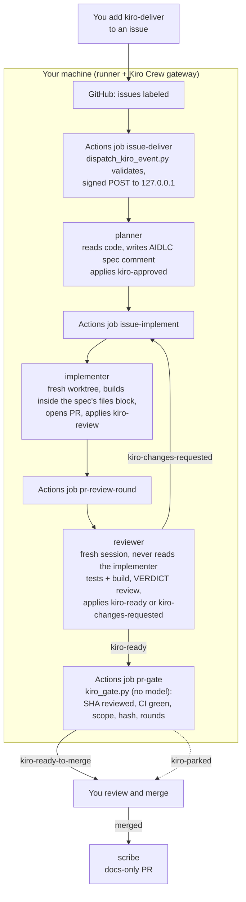

# 0. How it works

You write a GitHub issue and add one label. Five small Kiro Crew agents, running on your own machine, take it from there: one writes a specification, one implements it, one reviews it independently, a script checks the result, and one updates the docs after you merge. Each hands off to the next through a GitHub label. You read the final pull request and decide whether to merge.

## Using it

**1. Write the issue.** Describe the behaviour you want the way you would for a colleague: what, why, and how you will know it is done. You do not need to name files. The planner reads the code and writes the specification; a clear issue gives a precise spec, and a vague one gets you a `kiro-needs-owner` label with questions instead of a guess.

```text
Title: Show a word count under the chat input

## What
Show a small muted word count beneath the chat input, formatted as "N words"
(singular "1 word"), updating as the user types.

## Why
Users drafting longer messages want to know how long their message is before sending.

## Acceptance
- A word count appears below the chat input and updates on every keystroke.
- Words are separated by whitespace; extra whitespace does not count.
- Empty input shows "0 words"; one word shows "1 word".
- Existing tests pass; new tests cover 0, 1, many words and extra whitespace.
- No change to the backend API or message data shape.
```

**2. Add the `kiro-deliver` label.** This is the "go" signal. Only the repository owner's label counts; a label from anyone else is refused. You can add it when you create the issue.

**3. Wait a few minutes.** Watch the labels move: `kiro-approved` on the issue within about a minute, then a pull request on `kiro/issue-<number>` labelled `kiro-review`, then `kiro-ready`, then `kiro-ready-to-merge`. In testing the whole run took 6 to 8 minutes. Each agent's report arrives as a dashboard notification titled `Webhook: GitHub <repo>`.

**4. Decide.** Open the PR. The reviewer's `VERDICT:` review and the gate's "Delivery gate: PASS" comment tell you what was checked. CI has run. Read the diff, try the change, and merge it if it is right. Nothing merges on its own. After you merge, the scribe opens a docs-only PR if the change needs documenting.

## What happens behind the scenes



In words:

1. Adding a label sends an event from GitHub to a small workflow in your repo. Every label in the lifecycle has one job in that workflow.
2. The job runs on your machine, on a GitHub Actions runner you installed. It checks out the repo's default branch, never PR code, and runs a short script.
3. The script checks the event: right repository, right label, the owner wrote the issue and applied the label, the issue is open, and for PR labels, the owner opened the PR and it is on a `kiro/issue-N` branch of this repository. It strips hidden text (HTML comments, invisible characters) and passes the GitHub text to Kiro Crew as data, not as commands, in a signed request to the local gateway.
4. The gateway routes the request to the agent template that owns this label. Each role has its own webhook source, so each runs with only its own rules. It starts a fresh session for that one hop, does the work, writes the next label, and the session ends.
5. The next label fires the next job. No agent waits for another; nothing polls. The only timer is the optional auditor, which reports a label that has not moved.
6. The gate job is different: it runs a Python script with a GitHub token instead of an agent. It reads the PR through the API, never checks out PR code, and writes one comment and one label.

Everything runs on your machine with your GitHub login, so the PR, the review and the commits show your account.

## The labels

| Label | On | Means |
|---|---|---|
| `kiro-plan` | issue | Write a spec only; the owner approves by hand |
| `kiro-deliver` | issue | Write a spec and approve it automatically |
| `kiro-approved` | issue | Spec approved; implementer starts |
| `kiro-needs-owner` | issue | Planner held: too vague, or touches infra, credentials, auth or data deletion. Read the spec, then apply `kiro-approved` yourself |
| `kiro-task` | issue | Fast lane: implement the issue text directly, no spec, no review, no gate |
| `kiro-review` | PR | Waiting for the reviewer |
| `kiro-changes-requested` | PR | Reviewer found problems; implementer fixes (at most 3 rounds) |
| `kiro-ready` | PR | Reviewer approved; gate runs |
| `kiro-ready-to-merge` | PR | Gate passed; you may merge |
| `kiro-parked` | PR | Gate failed or round limit hit; you decide |

## Things to know

- **You can't steer a run.** Each hop is unattended and ephemeral. PR comments do not reach an agent; labels do. To get another review round after you edit the branch yourself, remove and re-add `kiro-review` ([doc 03, section 3.7](03-testing.md#37-re-running-a-hop)).
- **It stays in scope.** The spec lists the files that may change; the implementer stays inside them and the gate parks any PR that does not. Agents refuse instructions in the issue to run commands, change workflows, or touch credentials or infrastructure.
- **Where to watch it:** [doc 06, Watching a run](06-delivery-lifecycle.md#watching-a-run). The other limits (machine must be on, one branch per issue, private repo only) are in the [README](../README.md#limitations).

Setup from scratch: [07 Quick start checklist](07-quickstart-checklist.md). Reference: [06 Delivery lifecycle](06-delivery-lifecycle.md), [01 GitHub activation](01-github-activation.md), [02 Kiro Crew setup](02-kiro-crew-setup.md). Testing: [03](03-testing.md). Not your laptop: [05](05-run-on-a-remote-machine.md).
