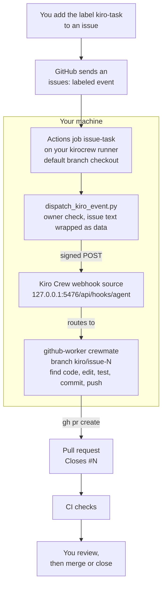

# 0. How it works

You write a GitHub issue and add one label. A Kiro Crew crewmate called `github-worker`, running on your own machine, finds the code, makes the change and opens a pull request. You read it and decide whether to merge.

## Using it

**1. Write the issue.** Describe the behaviour you want the way you would for a colleague. You can name the files and tests, or let the crewmate find them. It treats the issue as the specification, so a clear issue gives a small, correct PR. A vague one gives a guess. Asking it to list the files it found and changed in the PR makes the result easy to check.

```text
Title: Add a brown color theme

The website has selectable color themes (blue, green, pink). Add a fourth theme called brown.

- A brown option appears in the theme picker and works like the others.
- It changes the accent colors in light and dark mode, and is remembered after reload.
- Blue stays the default.

Find where the themes are defined and listed, follow the same pattern, update the tests,
and list the files you changed in the PR description. Do not touch unrelated code.
```

**2. Add the `kiro-task` label.** This is the "go" signal. Only the repository owner's label counts. A label from anyone else is refused.

**3. Wait a few minutes.** The crewmate creates a branch `kiro/issue-<number>`, makes the change, runs the tests, and opens a pull request that links back to the issue. In testing this took one to two and a half minutes. When it finishes you get a dashboard notification titled `Webhook: GitHub <repo>` with its report.

**4. Decide.** CI runs on the PR as usual. Review the diff and try the change yourself. Merge it if it is right, or close it and refine the issue. The crewmate never merges or deploys.

## What happens behind the scenes



In words:
1. Adding the label sends an event from GitHub to a small workflow in your repo.
2. The workflow runs on your machine, using a GitHub Actions runner you installed. It checks out the repo's main branch, never code from a PR.
3. A short script checks the event. It confirms the right repository and label and that the owner both wrote the issue and applied the label. It removes hidden text (HTML comments, invisible characters), then passes the issue text to Kiro Crew as data, not as commands, in a signed request to your local Kiro Crew.
4. Kiro Crew's webhook source routes the request to the `github-worker` crewmate. It starts a fresh session for that one task, does the work with the crewmate's instructions, and closes the session when it is done.

Everything runs on your machine with your GitHub login, so the PR and commits show your account, not the crewmate's name.

## Things to know

- **The machine must be on** and the runner running, or the task waits in GitHub until it is back. To stop depending on your laptop, use a remote Kiro Crew machine: see [05](05-run-on-a-remote-machine.md).
- **One task per issue.** Labelling the same issue again stops early if its branch already exists. Open a new issue for new work.
- **You can't steer a run.** Each run is unattended, and comments on the PR don't reach the crewmate. To change the result, edit the PR yourself or open a new issue.
- **Where to watch it.** The notification and the Webhooks page's Activity list show each run. The crewmate's own dashboard stays empty for webhook runs.
- **It stays in scope.** The crewmate refuses requests in the issue to run commands, change workflows, touch credentials or infrastructure, or widen the task. It explains why instead.
- **Use a private repository you own.** The setup is built for a single owner on a personal machine.

Setup: [01 GitHub activation](01-github-activation.md), [02 Kiro Crew setup](02-kiro-crew-setup.md). Testing: [03 Testing](03-testing.md). Not your laptop: [05 Run on a remote machine](05-run-on-a-remote-machine.md).
