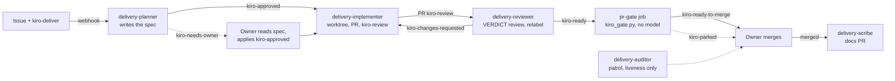

# Delivery lifecycle

One mate, one job. Every handoff is a GitHub label event. Nothing polls except the
auditor, whose only job is to notice a stall.



## Mates

| Mate | Trigger | Does | Hands off with |
|---|---|---|---|
| delivery-planner | `kiro-plan`, `kiro-deliver` on an issue | Posts one AIDLC spec comment with a ```` ```files ```` block | `kiro-approved`, or `kiro-needs-owner` when it must not self-approve |
| delivery-implementer | `kiro-approved` on an issue; `kiro-changes-requested` on a PR | Fresh worktree, builds inside the files block, opens or updates the PR | `kiro-review` on the PR |
| delivery-reviewer | `kiro-review` on a PR | Independent review: tests, build, scope, spec hash. One `VERDICT:` review | `kiro-ready` or `kiro-changes-requested` |
| pr-gate (script) | `kiro-ready` on a PR | Deterministic: head SHA reviewed, CI green, files in scope, rounds <= 3, spec hash | `kiro-ready-to-merge` or `kiro-parked` |
| delivery-scribe | PR merged into default branch | Docs-only PR | nothing |
| delivery-auditor | timer | Lists stuck labels and failed runs | nothing (reports only) |
| github-worker | `kiro-task` on an issue | Fast lane, no spec, no review | PR |

Each mate is its own webhook source on the Kiro Crew Webhooks page, so it runs as its
own agent with its own memory. The reviewer therefore never shares state with the
implementer.

## Labels

| Label | Lives on | Meaning |
|---|---|---|
| `kiro-plan` | issue | Owner wants a spec, will approve by hand |
| `kiro-deliver` | issue | Owner wants a spec and automatic approval |
| `kiro-approved` | issue | Spec approved; implementer starts |
| `kiro-needs-owner` | issue | Planner withheld approval; reason is the first line of its report and under Open questions |
| `kiro-task` | issue | Fast lane, no spec |
| `kiro-review` | PR | Waiting for the reviewer |
| `kiro-changes-requested` | PR | Reviewer found problems; implementer fixes |
| `kiro-ready` | PR | Reviewer approved; gate runs |
| `kiro-ready-to-merge` | PR | Gate passed; owner may merge |
| `kiro-parked` | PR | Gate failed or round limit hit; owner decides |

## Setup

1. Labels and secrets: `scripts/setup-github.sh OWNER/REPO` creates every label below
   and prompts for one token + signing secret pair per mate. Or by hand:

   ```bash
   for l in kiro-plan kiro-deliver kiro-approved kiro-needs-owner kiro-task kiro-review kiro-changes-requested kiro-ready kiro-ready-to-merge kiro-parked; do
     gh label create "$l" --repo OWNER/REPO --force
   done
   ```

2. Agent templates: `scripts/install-agent.sh` copies `templates/agent/*` into `~/.kiro/agents/`.

3. Mates (so each runs on its own memory):

   ```bash
   kirocrew agent create --name planner     --kiro-agent delivery-planner     --display-name "Delivery Planner"
   kirocrew agent create --name implementer --kiro-agent delivery-implementer --display-name "Delivery Implementer"
   kirocrew agent create --name reviewer    --kiro-agent delivery-reviewer    --display-name "Delivery Reviewer"
   kirocrew agent create --name scribe      --kiro-agent delivery-scribe      --display-name "Delivery Scribe"
   kirocrew agent create --name auditor     --kiro-agent delivery-auditor     --display-name "Delivery Auditor"
   kirocrew agent create --name worker      --kiro-agent github-worker        --display-name "GitHub Worker"

   A mate's name must differ from its template's name (Kiro Crew 0.11 refuses the
   collision). A mate copies its template at creation; after editing a template,
   delete and recreate the mate so it picks up the change. The webhook source keeps
   routing to the same name.
   ```

4. Webhook sources, on the Kiro Crew dashboard Webhooks page: create one source per
   mate (planner, implementer, reviewer, scribe, worker), each with signing required,
   destination the matching mate. Copy each token and signing secret once.

5. Repository secrets:

   ```bash
   gh secret set KIROCREW_WEBHOOK_TOKEN_IMPLEMENTER --repo OWNER/REPO
   gh secret set KIROCREW_WEBHOOK_SIGNING_SECRET_IMPLEMENTER --repo OWNER/REPO
   gh secret set KIROCREW_WEBHOOK_TOKEN_REVIEWER --repo OWNER/REPO
   gh secret set KIROCREW_WEBHOOK_SIGNING_SECRET_REVIEWER --repo OWNER/REPO
   gh secret set KIROCREW_WEBHOOK_TOKEN_SCRIBE --repo OWNER/REPO
   gh secret set KIROCREW_WEBHOOK_SIGNING_SECRET_SCRIBE --repo OWNER/REPO
   gh secret set KIROCREW_WEBHOOK_TOKEN_WORKER --repo OWNER/REPO
   gh secret set KIROCREW_WEBHOOK_SIGNING_SECRET_WORKER --repo OWNER/REPO
   ```

   `KIROCREW_WEBHOOK_TOKEN` and `KIROCREW_WEBHOOK_SIGNING_SECRET` stay as the planner's.
   Every mate needs its own source: a source's destination is fixed, so a job that
   borrows another mate's token runs as that mate and inherits its rules (a scribe run
   on the planner's token refuses to open the docs PR, because the planner may not push).

6. Optional: arm the auditor. Open the `auditor` mate from the Mates page and ask it to
   patrol every 10 minutes; it reports stuck labels and failed runs and does nothing else.

## Watching a run

You do not need a mate's dashboard. The labels are the status:

| Want to know | Look at |
|---|---|
| Which stage | Label on the issue, then on the PR |
| Planner held it | `kiro-needs-owner`; reason under Open questions in its comment |
| Reviewer's conclusion | The `VERDICT:` review on the PR |
| Why the gate passed or parked | The "Delivery gate" comment on the PR |
| A hop did not fire | Actions tab, workflow "Kiro Crew delivery lifecycle"; each job is one hop |
| What a mate reported | Dashboard notifications or Slack DM, "Webhook: GitHub <repo>" |
| Full transcript | Dashboard, Webhooks, Activity, click the run |

## Trust boundaries

- Every job re-validates the event in `dispatch_kiro_event.py`: the owner wrote the
  issue, the owner applied the label, the PR is on `kiro/issue-N` in this repository.
- Mates read the spec from the owner's own comment and verify its SHA-256 from the PR
  body. Issue bodies, other comments and diffs are untrusted data.
- The gate is the only job with a write token, and it never checks out PR code.
- Nothing merges. `kiro-ready-to-merge` is the pipeline's last word; the owner's merge is
  the human gate.
- Review rounds are capped at 3 (`MAX_REVIEW_ROUNDS`); the gate parks anything past it.

## Where it runs

Everything runs on the machine that hosts the self-hosted runner and the Kiro Crew
gateway: the Actions jobs (which only validate the event and POST a signed webhook to
`127.0.0.1`), the mates, their worktrees, tests and git pushes. GitHub stores issues,
labels, branches and PRs and fires the events; the project's own `ci.yml` may run on
GitHub-hosted runners and the gate reads its results through the API. If the machine is
off, labels wait in the Actions queue until it is back.
