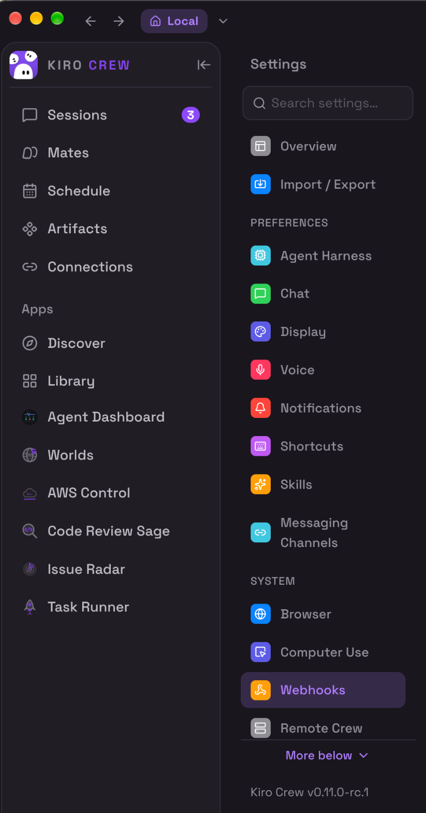
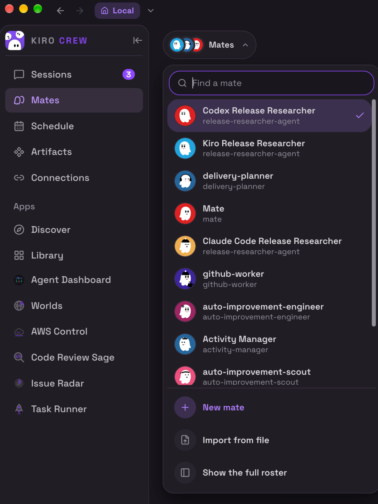
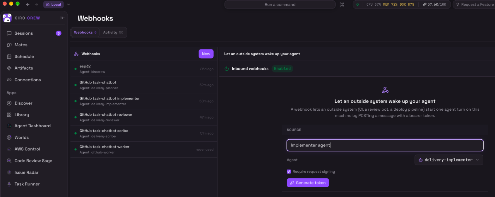
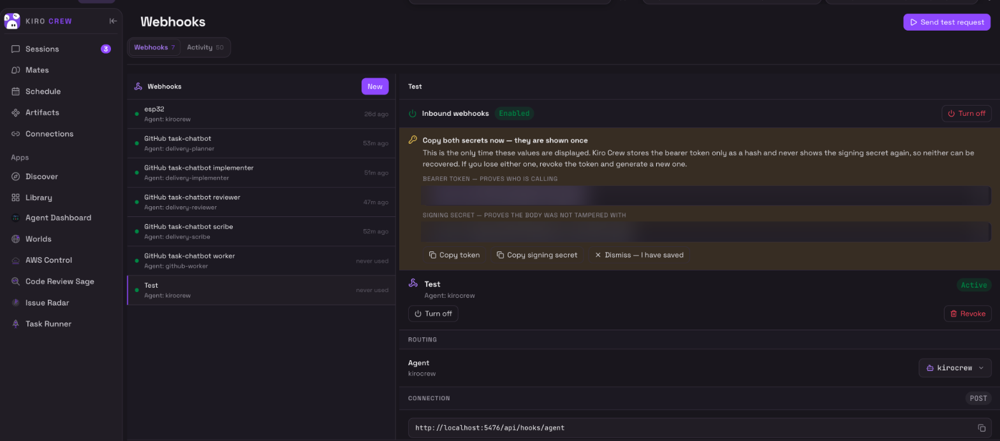
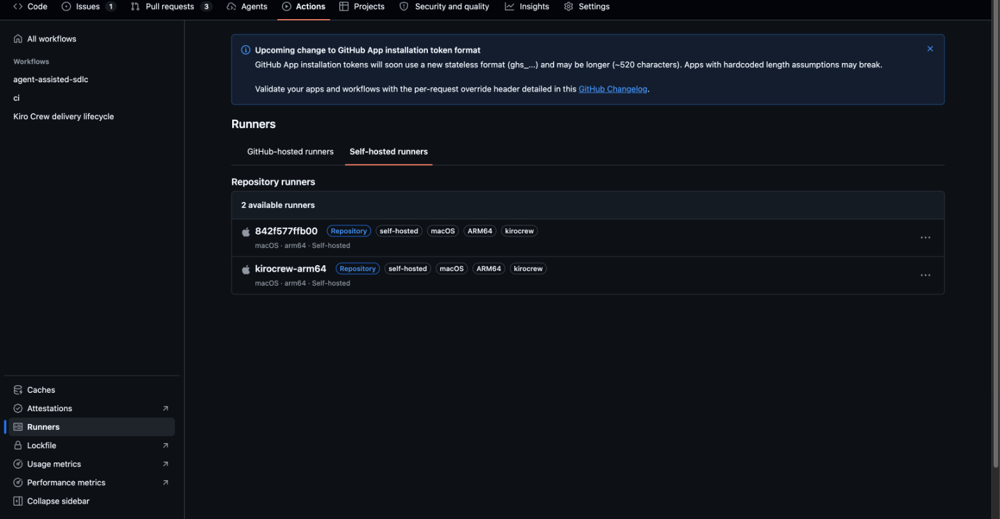
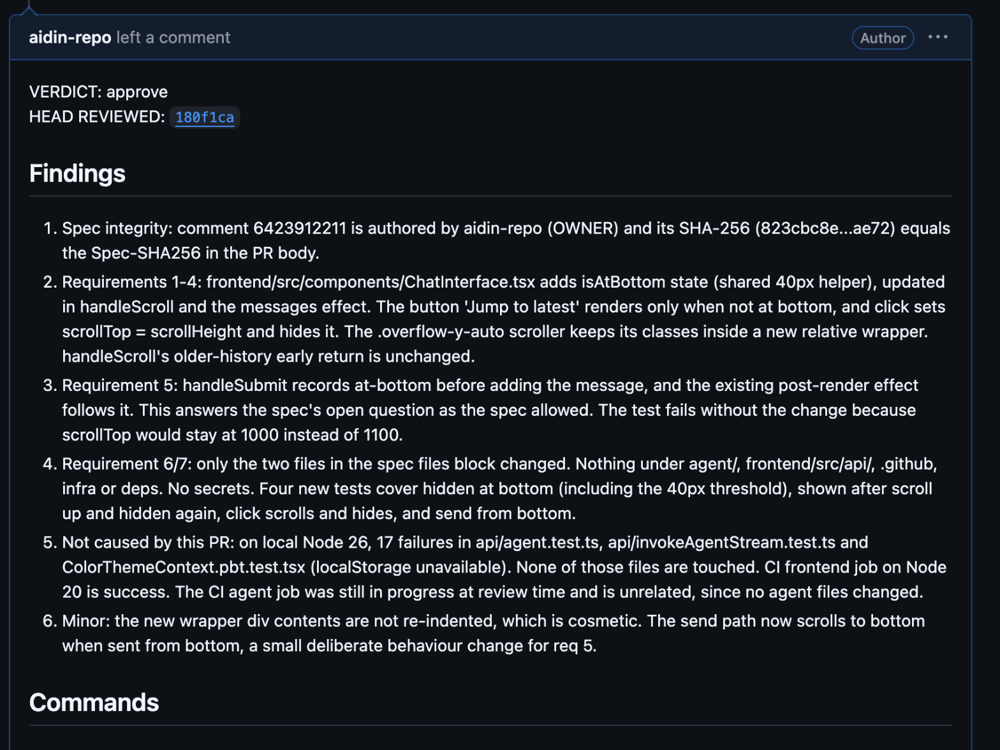
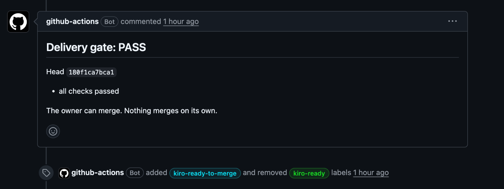

# 7. Quick start checklist: zero to first pull request

One ordered list. Tick each box before the next. If you have never used Kiro Crew or a self-hosted runner, budget about an hour; most of it is waiting for downloads and copying tokens.

Where a step is dashboard-only, a screenshot placeholder shows what you should see. Everything else is a command you paste into a normal terminal (not an agent chat; `~/.kiro/agents` and config files are protected from agent sessions).

## 0. Prerequisites

- [ ] **A private GitHub repository you own personally.** Org-owned repos do not work as written (doc 01, section 1.1). The setup scripts refuse public repos.
- [ ] **Kiro Crew 0.11 or newer**, installed and running on the machine that will do the work (your laptop, or a remote box per doc 05). Check: `kirocrew --version`. Older builds call mates "crewmates" and lack `--display-name`; the mate names in this guide may need adjusting there.
- [ ] **Kiro Crew signed in to a model.** Open any chat and send "hello". If it answers, you are signed in.
- [ ] **`gh` logged in as the repository owner:** `gh auth status`. Use a fine-grained token scoped to the one repository if you can.
- [ ] **`git`, `python3`, `curl` on PATH.** Check with `git --version && python3 --version && curl --version`.
- [ ] **The runtime your repo's CI uses** (for a Node project, the same Node major as `ci.yml`, via nvm or otherwise). The mates run your tests locally; if they cannot, they fall back to CI's results and say so.
- [ ] **A CI workflow on pull requests** in the repository (`.github/workflows/ci.yml` or similar). The gate requires at least one CI check on the PR head. If your repo has no CI yet, set `KIRO_GATE_REQUIRE_CI: "false"` on the `pr-gate` job after step 5, or the gate parks every PR.
- [ ] **This repository cloned:**

  ```bash
  git clone https://github.com/aidin-repo/kiro-crew-software-factory
  cd kiro-crew-software-factory
  ```

## 1. Kiro Crew: find the two pages

- [ ] Open the Kiro Crew dashboard. **Mates** is in the left sidebar. **Webhooks** is under **Settings** → **System** (the version is printed at the bottom of the Settings list; it must read 0.11 or newer). If either is missing on an older build, switch it on under **Settings** → **Developer** → **Feature Previews**.

  

## 2. Kiro Crew: install the six agent templates

- [ ] In a terminal, from the clone:

  ```bash
  scripts/install-agent.sh
  ```

  It copies `templates/agent/*` into `~/.kiro/agents/` and prints the six commands for the next step. Expected last lines: six `Installed ~/.kiro/agents/...` and the `kirocrew agent create` block.

## 3. Kiro Crew: create the six mates

- [ ] Paste the six commands the previous step printed:

  ```bash
  kirocrew agent create --name planner     --kiro-agent delivery-planner     --display-name "Delivery Planner"
  kirocrew agent create --name implementer --kiro-agent delivery-implementer --display-name "Delivery Implementer"
  kirocrew agent create --name reviewer    --kiro-agent delivery-reviewer    --display-name "Delivery Reviewer"
  kirocrew agent create --name scribe      --kiro-agent delivery-scribe      --display-name "Delivery Scribe"
  kirocrew agent create --name auditor     --kiro-agent delivery-auditor     --display-name "Delivery Auditor"
  kirocrew agent create --name worker      --kiro-agent github-worker        --display-name "GitHub Worker"
  ```

- [ ] Check:

  ```bash
  kirocrew agent list
  ```

  Each of the six rows shows its template in the `KIRO_AGENT` column and its own memory store. If `agent create` says "a template is already named X", you used the template's name as the mate's name; pick a different one.

- [ ] Open the **Mates** page in the dashboard, or the mate picker at the top of a chat. The six appear in the roster, each showing its template name underneath (**Show the full roster** if the picker is cut off).

  

## 4. Kiro Crew: one webhook source per mate

Repeat for each row. Have a terminal open beside the dashboard: each source shows its two values once, and you store them straight into GitHub.

| # | Source name | Agent (pick the **mate**) | Then run (paste token, Enter; paste signing secret, Enter) |
|---|---|---|---|
| 4a | `GitHub REPO planner` | `planner` | `gh secret set KIROCREW_WEBHOOK_TOKEN --repo OWNER/REPO` then `gh secret set KIROCREW_WEBHOOK_SIGNING_SECRET --repo OWNER/REPO` |
| 4b | `GitHub REPO implementer` | `implementer` | `..._TOKEN_IMPLEMENTER`, `..._SIGNING_SECRET_IMPLEMENTER` |
| 4c | `GitHub REPO reviewer` | `reviewer` | `..._TOKEN_REVIEWER`, `..._SIGNING_SECRET_REVIEWER` |
| 4d | `GitHub REPO scribe` | `scribe` | `..._TOKEN_SCRIBE`, `..._SIGNING_SECRET_SCRIBE` |
| 4e | `GitHub REPO worker` | `worker` | `..._TOKEN_WORKER`, `..._SIGNING_SECRET_WORKER` |

For each:

- [ ] **Settings** → **Webhooks** → **New**. Type the **Source** name. In the **Agent** dropdown pick the **mate** (`implementer`, not the `delivery-implementer` template; the dropdown lists both). Leave **Require request signing** checked. Click **Generate token**.

  

- [ ] A panel appears: **Copy both secrets now, they are shown once**, with the **bearer token** (`kc_whk_...`) and the **signing secret** (`kc_whs_...`). Run the two `gh secret set` commands from the table, pasting each value when prompted. Only then click **Dismiss, I have saved**.

  

- [ ] Check the new row in the left list reads `Agent: <mate name>` (for example `Agent: implementer`). If it reads the template name (`Agent: delivery-implementer`), the source will run on the shared template with the default memory instead of the mate: select the row, **Routing** → **Agent**, pick the mate. The token does not change.

- [ ] After all five:

  ```bash
  gh secret list --repo OWNER/REPO
  ```

  Ten `KIROCREW_*` names. If you skipped scribe or worker, those hops will 401 and nothing else is affected.

Alternative for the secrets: export all ten as environment variables and let `scripts/setup-github.sh OWNER/REPO` store them in step 5.

## 5. GitHub: labels, secrets, workflow

- [ ] Labels (and any secrets you did not set in step 4; press Enter to skip a pair you already stored):

  ```bash
  scripts/setup-github.sh OWNER/REPO
  ```

  Creates the ten `kiro-*` labels. Check them on the repository's Labels page.

- [ ] Install the workflow, dispatcher, gate, tests and mate templates into a local clone of your repository:

  ```bash
  gh auth setup-git
  scripts/install-into-repo.sh ~/code/REPO
  ```

  Then follow the printed commands: branch, test, commit, push, open the PR, **merge it**. The workflow only fires from the default branch.

- [ ] If your gateway is not on `127.0.0.1:5476`, add `KIROCREW_WEBHOOK_URL: http://127.0.0.1:PORT/api/hooks/agent` to every dispatch job's `env:` in `.github/workflows/kiro-crew-events.yml` before merging. The dispatcher refuses non-loopback addresses.

- [ ] If the repository has no CI workflow, set `KIRO_GATE_REQUIRE_CI: "false"` on the `pr-gate` job before merging.

## 6. GitHub: the runner on your machine

- [ ] Register the runner:

  ```bash
  scripts/install-runner.sh OWNER/REPO
  ```

- [ ] Start it in a terminal you keep open, and wait for "Listening for Jobs":

  ```bash
  cd ~/actions-runner-kirocrew
  ./run.sh
  ```

- [ ] Repository **Actions** → **Runners** (left sidebar) → **Self-hosted runners** shows it with labels `self-hosted`, `kirocrew`, and the OS and architecture of your machine.

  

To keep it running after you close the terminal: `./svc.sh install && ./svc.sh start` in the runner folder.

## 7. Verify

- [ ] Read-only checks; fix every FAIL:

  ```bash
  scripts/preflight.sh OWNER/REPO
  ```

- [ ] Full lifecycle smoke test (creates and then cleans up a real issue and PR):

  ```bash
  CLEANUP=1 scripts/smoke-test.sh OWNER/REPO
  ```

  Expected output, over 6 to 8 minutes: `kiro-approved`, `PR opened`, `kiro-review`, `kiro-ready`, `kiro-ready-to-merge`, then `PASS reviewer: VERDICT: approve`, `PASS gate: ## Delivery gate: PASS`, `PASS lifecycle complete`.

## 8. First real issue

- [ ] Write an issue with **What**, **Why** and **Acceptance** sections (doc 00 has an example). Add the `kiro-deliver` label.
- [ ] Watch the labels. When the PR reads `kiro-ready-to-merge`, open it, read the `VERDICT:` review and the gate comment, read the diff, merge.

  

  

- [ ] After the merge, the scribe may open a docs PR on `kiro/docs-pr-N`. Merge or close it.

## If something does not move

| Where it stopped | Look at |
|---|---|
| Issue still only `kiro-deliver` after 3 min | Actions tab: is `issue-deliver` queued (runner offline) or failed (read the log)? |
| Issue has `kiro-needs-owner` | The planner held. Read its comment's Open questions, then apply `kiro-approved` yourself |
| `kiro-approved` but no PR after 10 min | Actions: `issue-implement` result. Dashboard notification: the implementer's report |
| PR stuck at `kiro-review` after 10 min | Dashboard notification from the reviewer; re-add the label to retry |
| PR has `kiro-parked` | The gate comment lists each failed check |
| A mate ignores a prompt change you made | Its source routes to the template (`Agent: delivery-...`), not the mate; re-point it, or edit the template file directly |

Full troubleshooting: [doc 04](04-lessons-and-troubleshooting.md). How each piece works: [doc 06](06-delivery-lifecycle.md).
